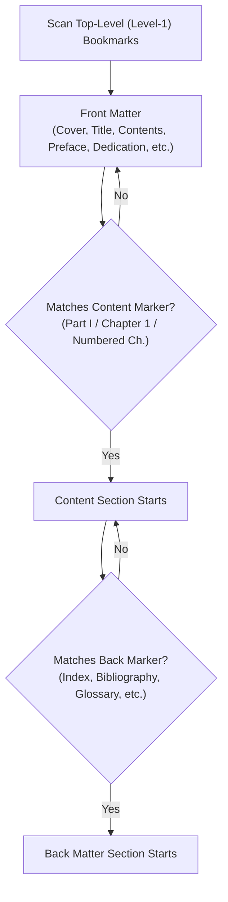

# PDF Bookmark Organizer

[](https://www.rust-lang.org/)
[](LICENSE)
[](https://crates.io/crates/lopdf)

A fast, lightweight, and safe command-line tool written in pure Rust to automatically reorganize existing PDF outlines into standard publishing divisions:

- **Front Matter** (Cover, Preface, Contents, Dedication, etc.)
- **Content** (Parts, Chapters, Sections, Appendices)
- **Back Matter** (Bibliography, Index, Glossary, Credits, etc.)

It carries over original bookmark titles, page destinations, and hierarchy, nesting them neatly beneath the three structural headings.

> [!NOTE]
> **Zero Page Content Modification**: This tool operates purely on the PDF document's outline catalog. It never alters, recompresses, or modifies page contents, text streams, or images.

---

## Visual Overview

### Before Reorganization
```text
PDF Outline
├── Cover Page
├── Table of Contents
├── Preface
├── Part I: Fundamentals
│   ├── Chapter 1: Introduction
│   └── Chapter 2: Core Concepts
├── Chapter 3: Advanced Topics
├── Appendix: Mathematical Review
│   ├── A Sets and Functions
│   └── B Linear Algebra
├── Bibliography
└── Subject Index
```

### After Reorganization
```text
PDF Outline
├── [STRUCTURAL] Front Matter
│   ├── Cover Page
│   ├── Table of Contents
│   └── Preface
├── [STRUCTURAL] Content
│   ├── Part I: Fundamentals
│   │   ├── Chapter 1: Introduction
│   │   └── Chapter 2: Core Concepts
│   ├── Chapter 3: Advanced Topics
│   └── Appendix: Mathematical Review
│       ├── A Sets and Functions
│       └── B Linear Algebra
└── [STRUCTURAL] Back Matter
    ├── Bibliography
    └── Subject Index
```

---

## Key Features

- **Non-Destructive Outline Restructuring**: Preserves original bookmark titles, 1-based target pages, and relative hierarchy.
- **Safe Dry-Run Mode**: Inspect the parsed outline and preview the proposed hierarchy before writing to disk using `--dry-run`.
- **Pure Rust Implementation**: Powered by [`lopdf`](https://crates.io/crates/lopdf) with zero unsafe code and no C runtime dependencies (no MuPDF or AGPL licensing requirements).
- **Intelligent Boundary Heuristics**:
  - Automatically identifies Front Matter items (acknowledgments, prefaces, forewords, dedications, etc.).
  - Detects Content starts from numbered chapters, "Part" boundaries (Roman numerals or words/numbers), and chapter prefixes.
  - Recognizes true Back Matter (indexes, bibliographies, glossaries, credits, EULAs) while keeping mid-content references or appendices under Content.
- **Appendix Hierarchy Auto-Correction**: Fixes flat appendix sections by nesting lettered entries (e.g. `A Sets`) under their parent `Appendix` heading.
- **Safety Checks**: Prevents accidental overwriting of the input file if input and output resolve to the same path.

---

## Installation & Prerequisites

### Prerequisites

- [Rust & Cargo](https://www.rust-lang.org/tools/install) **1.85+** (Rust 2024 edition).

### Build from Source

```powershell
# Clone or navigate to the repository
cd pdf-bookmark-organizer

# Build optimized release binary
cargo build --release
```

The compiled binary will be located at `target/release/pdf-bookmark-organizer` (or `pdf-bookmark-organizer.exe` on Windows).

### Optional: Install Locally

Install the binary directly into your Cargo bin directory (`~/.cargo/bin`):

```powershell
cargo install --path .
```

---

## Usage

```text
pdf-bookmark-organizer [OPTIONS] <INPUT>
```

### CLI Arguments & Options

| Option / Flag | Description |
| :--- | :--- |
| `<INPUT>` | *(Required)* Path to the source PDF file. |
| `-o`, `--output <PATH>` | Output PDF path. *(Defaults to `<input> - Revised Bookmarks.pdf`)* |
| `--dry-run` | Print diagnostic tables and proposed outline without modifying or saving files. |
| `-h`, `--help` | Print help information. |
| `-V`, `--version` | Print version information. |

---

### Examples

#### 1. Dry Run (Preview Only)
Preview the bookmark classification and planned structure without creating or modifying any file:

```powershell
# Using cargo
cargo run -- "C:\Books\Sample.pdf" --dry-run

# Or with compiled binary
.\target\release\pdf-bookmark-organizer.exe "C:\Books\Sample.pdf" --dry-run
```

#### 2. Default Output Path
Generates `C:\Books\Sample - Revised Bookmarks.pdf` in the same directory:

```powershell
cargo run -- "C:\Books\Sample.pdf"
```

#### 3. Custom Output Destination
Specify an explicit output file:

```powershell
cargo run -- "C:\Books\Sample.pdf" --output "C:\Books\Sample_Reorganized.pdf"
```

---

## Classification Rules

The organizer scans top-level (level-1) outline entries sequentially to determine global document partitions:



1. **Front Matter**:
   - Every top-level bookmark preceding the first Content marker is classified as Front Matter.
   - Matches keywords such as: `cover`, `half title`, `title page`, `copyright`, `dedication`, `contents`, `table of contents`, `toc`, `preface`, `foreword`, `about the author(s)`, `acknowledgments`, `acronyms`, `list of figures/tables/illustrations/abbreviations`.
2. **Content Boundary**:
   - Content starts at the first top-level Part marker (e.g., `Part 1`, `Part One`, `Part I`), numbered chapter pattern (`Chapter 1`, `Ch. 2`, `1 Introduction`, `1. Getting Started`), or Roman numeral part (`I Overview`).
   - Descendants inherit the classification of their top-level ancestor.
3. **Back Matter Boundary**:
   - Back Matter begins at the first recognized top-level back marker appearing **after** the Content start.
   - Matches: `bibliography`, `selected bibliography`, `glossary`, `index`, `subject index`, `author index`, `name index`, `general index`, `credits`, `photo/illustration/image credits`, `eula`.
   - **Chapter-End Material**: Items like `Appendix`, `References`, `Further Reading`, `Answers`, and `Solutions` do *not* automatically start global Back Matter—they remain classified under Content.
4. **Hierarchy Rules & Normalization**:
   - Existing level-1 bookmarks become level-2 children under their respective structural heading (`Front Matter`, `Content`, or `Back Matter`).
   - Sub-branches maintain their relative depths (`level + 1`).
   - Lettered sections (e.g. `A ...`, `B ...`) following an `Appendix` bookmark are automatically nested under the Appendix parent.

---

## Project Structure

```text
src/
├── main.rs            # Executable entry point and error handling
├── lib.rs             # Library root exposing internal modules
├── cli.rs             # Command-line interface definition (clap derive)
├── app.rs             # Pipeline orchestration (read -> classify -> rebuild -> write)
├── model.rs           # Core domain models (Bookmark, OutlineEntry, Section)
├── classification.rs  # Heuristic pattern matching and section assignment
├── hierarchy.rs       # Replacement outline generation, validations & fixes
├── pdf.rs             # PDF loading, TOC reading, and outline serialization via lopdf
└── diagnostics.rs     # Diagnostic output formatting and proposed outline tree
```

---

## Technical Considerations & Limitations

- **Source Outline Requirement**: The input PDF must already contain readable bookmark objects with internal page destinations. PDFs without existing outlines cannot be reorganized.
- **Action & Destination Forms**: The tool leverages `lopdf`'s Table of Contents parser. Any bookmark entries using non-standard or unsupported PDF destination actions will generate warnings during reading. Always inspect warnings in `--dry-run` mode before writing.
- **Encrypted Files**: Encrypted or password-locked PDFs are not supported.
- **PDF Serialization**: `lopdf` rebuilds the outline dictionary and serializes the PDF file upon saving. While page content streams are untouched, file formatting and internal object offsets may differ from the source document.

---

## Testing & Quality Assurance

Run the automated test suite:

```powershell
cargo test
```

Run code formatting and linter checks:

```powershell
cargo fmt --check
cargo clippy
```

---

## License

This project is licensed under the [MIT License](LICENSE).
